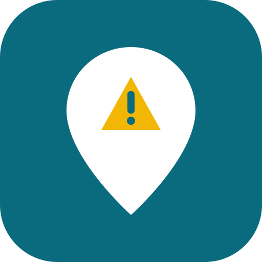
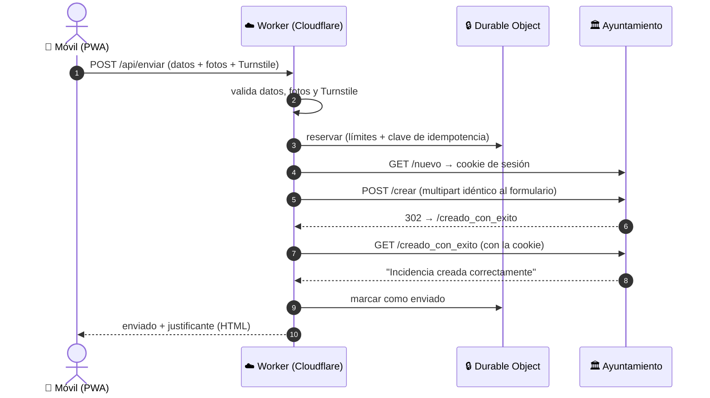

<div align="center">



# Avisos El Campello

**Avisa al Ayuntamiento de El Campello de lo que está roto en la calle, desde el móvil y en cuatro toques.**

[](https://github.com/davidcasanovasola-git/avisos-el-campello/actions/workflows/ci.yml)
[](https://workers.cloudflare.com/)
[](#)
[](LICENSE)

[**🚀 Abrir la app**](https://avisos-el-campello.davidcasanovasola.workers.dev) · [Cómo funciona](#cómo-funciona) · [Desplegar la tuya](#despliegue-en-cloudflare) · [El formulario del Ayuntamiento](FORM_NOTES.md)

</div>

> [!IMPORTANT]
> **App ciudadana no oficial.** No pertenece al Ayuntamiento de El Campello. Envía los avisos a su [formulario público de incidencias](https://intranet.elcampello.es/incidencias-extranet/nuevo) con los datos de quien lo usa.

## ✨ Qué hace

| | |
|---|---|
| 📷 **Foto al momento** | Abre la cámara trasera directamente. Hasta 3 fotos, recomprimidas a ≤ 800 KB. |
| 📍 **Ubicación precisa** | GPS de alta precisión (espera a ±15 m o 20 s), mapa de OpenStreetMap con pin arrastrable y coordenadas EXIF de cada foto. |
| 🏷️ **Tipos rápidos** | Bordillo amarillo, marcas viales, espejo, señales, pavimento, alumbrado, mobiliario… con un texto formal propuesto y editable. |
| 🗺️ **Dirección automática** | La calle y el número salen del mapa (OpenStreetMap). Se pueden corregir a mano. |
| 🔐 **Tus datos, en tu móvil** | Un solo formulario al principio. Se guardan cifrados (AES-GCM) con una clave no exportable del propio navegador. Sin contraseñas, y el servidor no los guarda. |
| 🗂️ **Historial** | Estado de cada aviso, notas ("ya lo han arreglado"), exportación CSV y **justificante PDF** para reclamar. |
| 📶 **Sin cobertura** | El aviso queda pendiente y se envía cuando lo confirmas. |
| 🛡️ **Sin duplicados ni abusos** | Turnstile, límites por día y por dispositivo, idempotencia y **ningún reintento automático**. |

## Cómo funciona



El formulario del Ayuntamiento **no tiene CAPTCHA ni token CSRF, y no devuelve número de parte**. El justificante es la respuesta de su servidor más lo enviado. Todos los detalles están en [FORM_NOTES.md](FORM_NOTES.md).

## Arquitectura (Cloudflare)

```
public/            PWA estática (Workers Static Assets)
  app.js           lógica de pantallas
  js/cripto.js     cifrado de datos personales (PBKDF2 + AES-GCM)
  js/db.js         historial en IndexedDB
  js/imagen.js     EXIF GPS, compresión (≤1600 px, ≤800 KB) y miniaturas
  js/textos.js     tipos de incidencia y redacción del texto
  js/pdf.js        justificante PDF
  sw.js            funcionamiento sin conexión
src/
  worker.js        API: /api/config, /api/geocodificar, /api/enviar
  form-map.js      ★ MAPEO DEL FORMULARIO DEL AYUNTAMIENTO (único fichero a tocar si cambia)
  limiter.js       Durable Object: límites, antiduplicado y cola de Nominatim (1 petición/s)
scripts/
  vendor.mjs       copia Leaflet, jsPDF y exifr a public/vendor
  simulador-ayto.mjs  imita el formulario del Ayuntamiento para probar sin enviar nada real
```

**Envío (`/api/enviar`):** valida datos y fotos → (modo real) verifica **Turnstile** → reserva en el Durable Object (límites e idempotencia) → `GET /nuevo` para obtener la cookie `laravel_session` → `POST /crear` en multipart, idéntico al formulario → se exige un **302 a `/creado_con_exito`** → `GET` de esa página con la cookie → busca `alert-success`.

Ante cualquier duda (timeout, respuesta rara) el aviso se marca **"Sin confirmar"** y **nunca se reintenta solo**. Cada aviso lleva una clave de idempotencia: si se reenvía durante 48 h, el servidor responde que ya se envió.

**Interruptor general:** con `ENVIO_REAL=0` el servidor no envía nada al Ayuntamiento. La app muestra "Envíos desactivados" y los avisos se pueden guardar como pendientes. Sirve para cortar los envíos de golpe si el Ayuntamiento cambia el formulario. Para probar sin enviar avisos reales está el simulador local (abajo).

## Desarrollo local

Requisitos: Node 20+.

```bash
npm install
```

```bash
cp .dev.vars.example .dev.vars
```

```bash
npm run dev
```

Abre http://localhost:8787. `npm run dev` arranca **siempre con los envíos desactivados** y la clave de prueba de Turnstile, aunque `wrangler.jsonc` tenga los de producción. En localhost el navegador permite la cámara y el GPS sin HTTPS.

> **Windows:** si `wrangler dev` falla con `SQLITE_CANTOPEN`, la ruta del proyecto es demasiado larga para el SQLite del Durable Object. Usa `npx wrangler dev --persist-to C:/tmp/avisos-state`.

**Probar el envío real sin tocar el Ayuntamiento:**

```bash
node scripts/simulador-ayto.mjs
```

```bash
npm run dev:simulador
```

`SIM_MODO=error` simula un rechazo por validación y `SIM_MODO=lento` simula un Ayuntamiento que no responde (el aviso debe acabar en "Sin confirmar").

Tests:

```bash
npm test
```

## Despliegue en Cloudflare

Hace falta una cuenta de Cloudflare (el plan gratuito basta).

1. Inicia sesión desde tu terminal (se abre el navegador):
   ```bash
   npx wrangler login
   ```
2. **Turnstile:** en el panel de Cloudflare → *Turnstile* → *Add widget*. Pon el dominio donde vivirá la app (por ejemplo `avisos-el-campello.<tu-subdominio>.workers.dev`), modo *Managed*. Copia la **site key** en `TURNSTILE_SITEKEY` de `wrangler.jsonc` y guarda la **secret key** como secreto:
   ```bash
   npx wrangler secret put TURNSTILE_SECRET
   ```
3. En `wrangler.jsonc`, pon en `CONTACT_EMAIL` un email de contacto. Lo exige la [política de Nominatim](https://operations.osmfoundation.org/policies/nominatim/).
4. Despliega:
   ```bash
   npm run deploy
   ```
   Queda en `https://avisos-el-campello.<tu-subdominio>.workers.dev`, con HTTPS automático (obligatorio para la cámara y el GPS). Opcionalmente, añade un dominio propio en *Workers → Settings → Domains & Routes*.
5. **Activar los envíos:** cambia `ENVIO_REAL` a `"1"` y vuelve a desplegar. Antes, prueba el flujo completo contra el simulador local.

Para actualizar: `npm run deploy`. Si cambias ficheros de `public/`, sube `VERSION` en `public/sw.js` para que los móviles cojan la versión nueva.

### Límites (en `wrangler.jsonc`)

| Variable | Por defecto | |
|---|---|---|
| `LIMITE_DIA_IP` / `LIMITE_DIA_DISPOSITIVO` | 10 | avisos reales por día |
| `SEGUNDOS_ENTRE_ENVIOS` | 120 | espera mínima entre dos avisos |
| `LIMITE_DIA_GLOBAL` | 100 | total de la app por día |


## Si cambia el formulario del Ayuntamiento

1. Abre https://intranet.elcampello.es/incidencias-extranet/nuevo, mira el HTML (Ver código fuente) y compáralo con la tabla de [FORM_NOTES.md](FORM_NOTES.md#3-campos-en-el-orden-del-formulario).
2. Cambia **solo** `src/form-map.js`:
   - `URLS`: si cambian las direcciones.
   - `construirFormulario()`: nombres y orden de los campos. **Mantén el honeypot `email_importante` vacío.**
   - `esConfirmacion()` y `erroresValidacion()`: cómo se reconoce el éxito o el error.
3. Si aparece un CAPTCHA o un token CSRF: el token se puede leer en el `GET /nuevo` y reenviar. **Un CAPTCHA no se debe saltar.** En ese caso hay que pasar a "abrir el formulario oficial con los datos listos para copiar".
4. `npm test`, prueba contra el simulador local (actualízalo si cambió la respuesta), y haz un envío real revisado.

## Privacidad y seguridad

- Los datos personales (nombre y apellidos, email y teléfono) están cifrados en `localStorage` con AES-GCM. La clave la genera el navegador y se guarda en IndexedDB como **no exportable**: ningún script puede leerla, solo usarla en ese dispositivo. Esto protege los datos guardados (copias de seguridad, herramientas que lean `localStorage`). No hay PIN: quien tenga el móvil desbloqueado y abra la app puede enviar avisos, igual que en cualquier app con la sesión iniciada.
- El servidor recibe los datos solo al enviar, los reenvía al Ayuntamiento y no los guarda ni los escribe en los logs. Lo único que guarda son contadores, hashes de IP (con sal diaria) y estados de envío durante 48 h.
- Las fotos se recomprimen **sin EXIF**. Las coordenadas de la foto se copian aparte al texto, que es lo que se quiere.
- En **iPhone**, las fotos hechas desde el navegador normalmente **no traen GPS**. En ese caso solo se usa el GPS del móvil. Las fotos elegidas de la galería pueden traerlo, según los permisos.
- La respuesta del Ayuntamiento se muestra en un iframe aislado, sin scripts.
